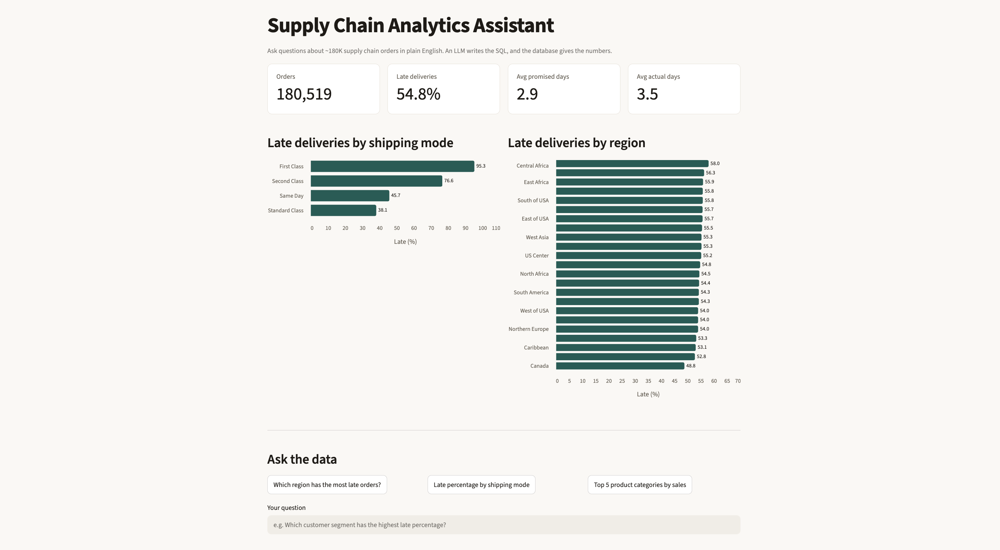

# Supply Chain Analytics Assistant

Ask questions about supply chain orders in plain English. An LLM (Google Gemini) turns each question into SQL, the SQL runs on a local SQLite database, and the answer appears in a Streamlit dashboard. The numbers come from the database, not from the model.



## What it does

- **Data pipeline:** cleans ~180K order records from the DataCo Smart Supply Chain dataset and loads them into SQLite
- **Natural-language assistant:** converts a business question into a SQL query, runs it, and shows the SQL, the result table and an automatic chart
- **Dashboard:** KPIs (orders, late delivery rate, promised vs actual shipping days) and charts of late deliveries by shipping mode and by region
- **Read-only by design:** generated SQL can never change the data (see below)

## How it works

```
CSV  ->  clean + load  ->  SQLite database
                                 ^
Question -> Gemini writes SQL -> safety check -> read-only query -> table + chart
```

1. `load_data.py` reads the CSV, standardises column names, trims stray whitespace in text columns, drops unused and personal-looking columns, and writes the `orders` table to SQLite.
2. `ask.py` sends the question plus the live table schema to Gemini and asks for one SQLite `SELECT` query.
3. The query is validated, then run on a read-only database connection.
4. `app.py` shows everything in a Streamlit page.

## Design decisions

- **Grounding:** the prompt includes the real column names (read from the database) and a definition of "late", so the model does not guess the structure of the data.
- **Two layers of safety:** the prompt asks for `SELECT` only, but the code does not rely on that. `is_safe()` accepts only a single `SELECT` statement, and the database is opened in read-only mode, so even a bad query cannot modify data. `test_guardrails.py` tests both layers.
- **Reliability:** API calls have a timeout, retry with exponential backoff on 429/500/503/504 errors, and fall back to a second model if the first keeps failing.
- **Input handling:** blank input is ignored, and questions the data cannot answer return a clear message instead of made-up SQL.
- **Metric definitions matter:** "late" in this dataset means slower than the promised shipping time for that mode. First Class has the highest late rate because it promises the shortest time. The dashboard says so next to the chart.

## Tech stack

Python, pandas, SQLite, SQL, Google Gemini API (`google-genai`), Streamlit, Altair, Git/GitHub

## Run it yourself

1. Download the **DataCo Smart Supply Chain for Big Data Analysis** dataset from Kaggle and put `DataCoSupplyChainDataset.csv` in the project folder. The data files are not included in this repo.
2. Install the libraries:
   ```
   pip install -r requirements.txt
   ```
3. Create a free API key in Google AI Studio and set it in your terminal (it is never stored in the code):
   ```
   export GEMINI_API_KEY="your_key_here"
   ```
4. Build the database:
   ```
   python load_data.py
   ```
5. Start the dashboard:
   ```
   streamlit run app.py
   ```

Model names change over time. If a model returns an error, update the `MODELS` list at the top of `ask.py`.

## Example questions

- Which region has the most late orders?
- What is the late delivery percentage for each shipping mode?
- Top 5 product categories by sales

## Project files

| File | Purpose |
|---|---|
| `load_data.py` | Cleans the CSV and loads it into SQLite |
| `ask.py` | Question to SQL, safety checks, query runner |
| `app.py` | Streamlit dashboard |
| `test_guardrails.py` | Checks that unsafe SQL is blocked |
| `.streamlit/config.toml` | Dashboard theme |

## Limitations and next steps

- LLM-written SQL is not always correct, and ambiguous questions can have more than one valid answer (for example "most late" by count vs by rate)
- No automated accuracy evaluation yet
- Planned: retrieval-augmented generation (RAG) over supply chain documents, and deployment